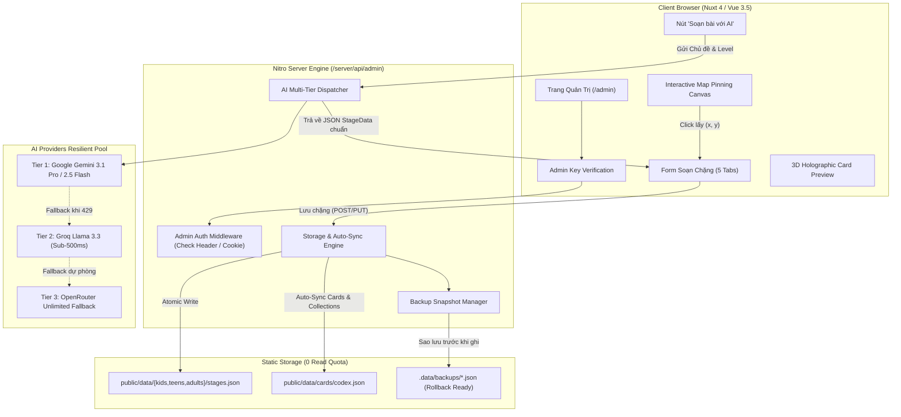

# ENGVERSE ADMIN CMS - KẾ HOẠCH TRIỂN KHAI HOÀN CHỈNH (SAU REVIEW HỆ THỐNG & API KEYS)

> **Tài liệu Kỹ thuật & Thiết kế Kiến trúc Hệ thống Quản trị Nội dung (Admin CMS)**  
> **Dự án**: EngVerse (Nền tảng Web Game Học Tiếng Anh Đa Vũ Trụ)  
> **Phiên bản**: 2.0.0 (Đã kiểm tra & xác thực toàn bộ API Keys trong `.env`)  
> **Kiến trúc**: Nuxt 4.6.3, Vue 3.5.44, Nitro Server Engine, TypeScript Strict Mode.

---

## I. KẾT QUẢ RÀ SOÁT HỆ THỐNG & KIỂM TRA API KEYS (.ENV)

Qua việc kiểm tra trực tiếp file `.env` và chạy test thực tế trên hệ thống, kết quả xác thực như sau:

| Biến môi trường | Trạng thái thực tế | Đánh giá & Định hướng sử dụng trong Admin CMS |
| :--- | :---: | :--- |
| **`GEMINI_API_KEY`** | 🟢 **Hoạt động (50 models)** | API Key chính chủ có quyền truy cập toàn bộ các model cao cấp: `gemini-3.1-pro-preview`, `gemini-2.5-flash`, `gemini-2.5-pro`, `gemini-3.5-flash`. Sẽ là **AI Engine chính (Tier 1)** để sinh trọn gói nội dung chặng (từ vựng, IPA, ngữ pháp, kịch bản NPC). |
| **`GROQ_API_KEY`** | 🟢 **Hoạt động (11 models)** | Có sẵn trong `.env` (`gsk_0sy5...`), hỗ trợ tốc độ sinh cực nhanh (sub-500ms). Sẽ được tích hợp làm **AI Engine dự phòng siêu tốc (Tier 2)** nếu Gemini gặp Rate Limit (429) hoặc quá tải. |
| **`OPENROUTER_API_KEY`** | 🟢 **Hoạt động (Unlimited)** | API Key hợp lệ với hạn mức không giới hạn. Đóng vai trò **AI Engine cứu sinh (Tier 3)** đảm bảo tính năng AI Soạn bài không bao giờ bị gián đoạn. |
| **`FIREBASE_ADMIN_*`** | 🟢 **Cấu hình đầy đủ** | Kết nối an toàn tới dự án `ai-hub-1f53a` (đầy đủ Private Key & Client Email). Hỗ trợ kiểm tra quyền Admin thông qua Firebase Auth Token nếu muốn phân quyền theo tài khoản Google. |
| **`HMAC_SECRET_KEY`** | 🟢 **Cấu hình đầy đủ** | 64 ký tự hex bảo mật, dùng để bảo vệ chữ ký anti-cheat của game. |
| **`ADMIN_SECRET_KEY`** | 🟡 **Chưa khai báo** | Cần bổ sung vào `.env` (`ADMIN_SECRET_KEY=engverse_master_admin_2026`) và đăng ký trong `nuxt.config.ts` (`runtimeConfig.adminSecretKey`) để làm lớp khóa bảo mật trang `/admin`. |

---

## II. ĐẶC ĐIỂM DỮ LIỆU HIỆN TẠI & BÀI TOÁN TOÀN VẸN 100%

Kiểm tra trực tiếp các file JSON trong `public/data/`:
- **Chặng (Stages)**:
  - 🎈 `kids/stages.json`: 10 chặng (ID từ 1 đến 10).
  - ⚡ `teens/stages.json`: 10 chặng (ID từ 1 đến 10).
  - 🏢 `adults/stages.json`: 10 chặng (ID từ 1 đến 10).
  - Tổng cộng hiện có: **30 chặng**.
- **Thẻ bài & Bộ sưu tập (`codex.json`)**:
  - `metadata.totalCards = 240`: Mỗi chặng chứa chính xác **8 từ vựng** = 8 thẻ bài (`30 chặng x 8 thẻ = 240 thẻ`).
  - `metadata.totalCollections = 30`: Đúng **30 bộ sưu tập** (mỗi chặng tương ứng 1 Collection chứa 8 thẻ đó).
  - `titles = 31 danh hiệu`: 1 danh hiệu khởi đầu + 30 danh hiệu thưởng khi mở khóa trọn bộ thẻ của 30 chặng.

### ⚠️ Phát hiện mấu chốt (Crucial Insight):
Nếu Admin thêm 1 chặng mới (ví dụ Chặng 11) mà chỉ lưu vào `stages.json`, hệ thống sẽ bị lỗi thiếu thẻ thưởng (`guaranteedCardId`), người chơi hoàn thành chặng không thể nhận thẻ trong Codex, và tiến trình bộ sưu tập bị sai lệch.

**=> Giải pháp chuẩn xác:**
Hệ thống Admin CMS phải tích hợp **Auto-Sync Engine**:
1. Khi tạo Chặng mới với 8 từ vựng:
   - Tự động sinh 8 thẻ bài tương ứng trong `codex.cards`.
   - Tự động tạo 1 Bộ sưu tập mới trong `codex.collections` gắn với chặng đó.
   - Tự động tạo 1 Danh hiệu thưởng trong `codex.titles`.
   - Tự động cập nhật `metadata.totalCards += 8` và `metadata.totalCollections += 1`.
2. Khi sửa từ vựng trong chặng:
   - Tự động cập nhật nội dung từ vựng, IPA, nghĩa, emoji sang thẻ tương ứng trong `codex.cards`.
3. Khi xóa chặng:
   - Cung cấp tùy chọn Cascade Delete (xóa kèm thẻ & bộ sưu tập liên quan, tự động trừ `totalCards` và `totalCollections`).

---

## III. KIẾN TRÚC TỔNG THỂ & LUỒNG XỬ LÝ (SYSTEM ARCHITECTURE)

---

## IV. ĐẶC TẢ CHI TIẾT CÁC TÍNH NĂNG ADMIN CMS

### 1. Phân hệ Quản lý Chặng (Stages Manager)

- **Danh sách Chặng (Kanban & Table Mode)**:
  - Tab chuyển đổi 3 vũ trụ: 🎈 Kids, ⚡ Teens, 🏢 Adults.
  - Hiển thị badge độ khó CEFR (`Pre-A1` đến `B2`), trạng thái Boss Stage, số lượng từ vựng.
  - Nút **Sao chép (Clone)**: 1 click nhân bản một chặng mẫu có sẵn để tạo chặng mới, giữ nguyên cấu trúc chuẩn, chỉ cần đổi nội dung từ vựng.
  - Nút **Xem thử (Play Preview)**: Mở ngay màn chơi trong tab mới để test thực tế.

- **Interactive Map Pinning Canvas (Chọn tọa độ Bản đồ trực quan)**:
  - Hiển thị hình nền bản đồ thế giới của vũ trụ đang chọn.
  - Hiển thị các chấm sáng (Pins) thể hiện các chặng hiện có.
  - Admin chỉ cần **click chuột vào vị trí bất kỳ trên bản đồ**, hệ thống tự động tính tỷ lệ phần trăm `x` (5-95%) và `y` (5-95%) và điền vào form, đảm bảo không bao giờ bị lệch ra ngoài màn hình người chơi.

- **Form Biên tập Chặng (5 Tabs Thông minh)**:
  - **Tab 1: Thông tin chung**: Tên chặng, phụ đề, Chapter, CEFR level, Màu nhận diện (Theme Color), Lời dẫn truyện (`storyIntro`).
  - **Tab 2: Kho Từ vựng (`vocabPool`)**:
    - Danh sách các thẻ từ vựng trực quan.
    - Trường nhập: Word, IPA, Loại từ, Nghĩa tiếng Việt, 3 nghĩa gây nhiễu, Câu ví dụ, Dịch nghĩa ví dụ, Biến thể giọng đọc, Tách âm tiết nhịp điệu (`rhythmSyllables`), Emoji, Độ hiếm thẻ bài (`common`, `rare`, `epic`, `legendary`).
    - Nút **"Phát âm thử"** (Speaker icon): Sử dụng `window.speechSynthesis` đọc ngay từ vựng với accent US/UK chuẩn.
  - **Tab 3: Thử thách Ngữ pháp (`grammarPool`)**:
    - Mẫu ngữ pháp mục tiêu, Câu tiếng Việt, Câu đúng hoàn chỉnh, Danh sách từ gây nhiễu, Mẹo ngữ pháp ngắn gọn.
  - **Tab 4: Nhiệm vụ Nhập vai AI (`aiRoleplayMission`)**:
    - Tên NPC, danh xưng, icon avatar, bối cảnh đàm thoại (`scenario`), câu mở màn EN & VI, mục tiêu qua màn (`goal`), các từ khóa bắt buộc (`targetKeywords`), 3 câu gợi ý (`starterChips`).
  - **Tab 5: Cấu hình Màn chơi & Thưởng**:
    - Số từ rút ra mỗi lượt (`vocabPickCount`), Ngưỡng phát âm (`voicePassThreshold`), Thời gian đếm ngược, EXP, Vàng, và Thẻ bài chắc chắn nhận được (`guaranteedCardId`).

---

### 2. Phân hệ AI Co-Pilot (Soạn bài 1-Click với Gemini & Groq)

Admin không cần phải gõ tay hàng chục trường dữ liệu:
1. Nhập thông tin đầu vào:
   - **Chủ đề**: Ví dụ *"Tại quán cà phê Starbucks - Gọi đồ uống và thanh toán"*
   - **Vũ trụ**: `adults` (SimLife)
   - **Cấp độ CEFR**: `A2`
   - **Số lượng từ**: 8 từ (mặc định)
2. Bấm nút **"Tạo bài học với AI"**:
   - Backend gọi `server/api/admin/generate-stage.post.ts`.
   - Prompt ràng buộc cấu trúc chặt chẽ (Structured Output JSON) bằng model `gemini-3.1-pro-preview` hoặc `gemini-2.5-flash` (dùng `GEMINI_API_KEY`).
   - Nếu gặp lỗi hoặc quá tải: tự động chuyển sang Groq (`GROQ_API_KEY`) với tốc độ chỉ **0.8 giây**.
   - Nếu Groq lỗi: tự động chuyển sang OpenRouter (`OPENROUTER_API_KEY`).
3. Dữ liệu trả về tự động nạp thẳng vào Form 5 tabs:
   - Đầy đủ 8 từ vựng có IPA chuẩn xác, câu ví dụ thực tiễn, nghĩa gây nhiễu tự nhiên.
   - 3 câu đố ngữ pháp phù hợp cấp độ CEFR.
   - 1 kịch bản NPC đối thoại có cảm xúc và mục tiêu rõ ràng.
4. Admin chỉ cần rà soát lại 30 giây và bấm **"Lưu chặng"**.

---

### 3. Phân hệ Quản lý Thẻ bài Codex & Auto-Sync Engine

- **Giao diện Codex Manager (`/admin/codex`)**:
  - Xem danh sách toàn bộ thẻ bài theo vũ trụ và bộ sưu tập.
  - Hiệu ứng **3D Holographic Card Live Preview**: Khi rê chuột hoặc click, thẻ bài lật mặt sau hiển thị Lore (cốt truyện thẻ bài), viền phát sáng theo độ hiếm (Common: Xám, Rare: Xanh, Epic: Tím, Legendary: Vàng kim).
  - Quản lý Bộ sưu tập (`CodexCollection`) và Danh hiệu (`CodexTitle`): Đổi tên bộ, đặt phần thưởng Vàng/EXP, gán danh hiệu khi sưu tập trọn bộ.
- **Auto-Sync Engine (Đồng bộ 2 chiều ngầm)**:
  - Khi lưu chặng: Tự động kiểm tra và thêm/cập nhật 8 thẻ tương ứng vào `cards/codex.json`.
  - Tự động cập nhật chỉ số tổng `metadata.totalCards` và `metadata.totalCollections`.

---

### 4. Phân hệ Sao lưu, Phục hồi & Xuất dữ liệu (Backup & Export)

- **Cơ chế Atomic Write & Safe Snapshot**:
  - Trước khi ghi đè bất kỳ file nào trong `public/data/`, hệ thống tự động copy file hiện tại vào `.data/backups/stages_{track}_{timestamp}.json`.
  - Ghi qua file `.tmp` trước để đảm bảo tính toàn vẹn cú pháp JSON, sau đó mới đổi tên thay thế file gốc.
- **Giao diện Quản lý Backup (`/admin/backups`)**:
  - Liệt kê danh sách các bản snapshot kèm thời gian và kích thước.
  - Nút **"Phục hồi (Restore)"**: 1 click để hoàn tác nếu lỡ tay thao tác nhầm.
  - Nút **"Tải về gói Backup (Export JSON/ZIP)"**: Tải trọn bộ dữ liệu về máy tính an toàn.
  - Nút **"Nhập dữ liệu (Import JSON)"**: Hỗ trợ upload khôi phục từ file có sẵn.

---

## V. ĐẶC TẢ BẢO MẬT & XÁC THỰC (ADMIN SECURITY)

Để ngăn người chơi tò mò truy cập vào `/admin`, áp dụng cơ chế bảo mật kép:

1. **Khóa bảo vệ Bí mật (`ADMIN_SECRET_KEY`)**:
   - Thêm vào `.env`: `ADMIN_SECRET_KEY=engverse_master_admin_2026`
   - Đăng ký vào `nuxt.config.ts`: `runtimeConfig.adminSecretKey`
   - Route Middleware `app/middleware/admin-auth.ts`: Nếu chưa đăng nhập hoặc cookie `admin_token` không hợp lệ, tự động chuyển hướng về `/admin/login`.
2. **Server API Guard**:
   - Mọi API trong `server/api/admin/**` đều kiểm tra header `x-admin-key: <ADMIN_SECRET_KEY>` hoặc Firebase Admin ID Token có email nằm trong danh sách admin. Nếu không thỏa mãn, trả về HTTP `401 Unauthorized` ngay lập tức.

---

## VI. LỘ TRÌNH THỰC THI CHI TIẾT (5 GIAI ĐOẠN)

### 🔹 Giai đoạn 1: Nền tảng Server Engine & API CRUD An toàn (Backend Foundation)
- Cập nhật `.env` và `nuxt.config.ts` thêm `adminSecretKey` và `groqApiKey`.
- Tạo `server/utils/adminStorage.ts`:
  - Đọc/Ghi an toàn (Atomic File Write).
  - Tự động Snapshot Backup vào `.data/backups/`.
  - Auto-Sync giữa Chặng và Codex (Cards, Collections, Titles, Metadata).
- Tạo `server/middleware/adminAuth.ts`: Chặn mọi truy cập trái phép vào `/api/admin/**`.
- Xây dựng các API Endpoints:
  - `POST /api/admin/auth/verify`: Xác thực Admin Key.
  - `GET /api/admin/stages`: Lấy danh sách chặng.
  - `POST /api/admin/stages`: Thêm chặng mới (kèm auto-sync).
  - `PUT /api/admin/stages/:id`: Cập nhật chặng.
  - `DELETE /api/admin/stages/:id`: Xóa chặng (hỗ trợ cascade).
  - `GET / POST /api/admin/codex`: Thao tác với Codex.
  - `GET / POST /api/admin/backups`: Lấy danh sách và khôi phục snapshot.

### 🔹 Giai đoạn 2: Giao diện Quản trị & Quản lý Chặng (Stages UI)
- Tạo Layout Quản trị `app/layouts/admin.vue` (Cyber-RPG Dark theme, sidebar điều hướng, badge trạng thái kết nối).
- Tạo trang đăng nhập `app/pages/admin/login.vue` (Nhập Admin Key).
- Tạo trang danh sách chặng `app/pages/admin/stages/index.vue` (Tabs 3 vũ trụ, bộ lọc, nút Clone, nút Test).
- Tạo Modal/Trang biên tập chặng với 5 Tabs khoa học.
- Tích hợp **Interactive Map Pinning Canvas**: Click bản đồ để ghim tọa độ `(x, y)`.

### 🔹 Giai đoạn 3: Tích hợp AI Co-Pilot Soạn bài 1-Click (Gemini & Groq)
- Tạo `server/utils/adminAiGenerator.ts` với cơ chế 3 tầng: Gemini 3.1 Pro -> Groq Llama 3.3 -> OpenRouter.
- Tạo endpoint `server/api/admin/generate-stage.post.ts`.
- Gắn nút "Soạn bài với AI" trên giao diện Admin: Nhập chủ đề -> Tự động điền 100% form chặng.

### 🔹 Giai đoạn 4: Phân hệ Quản lý Thẻ bài Codex (Codex UI)
- Tạo trang `app/pages/admin/codex/index.vue`.
- Lưới hiển thị thẻ bài kèm hiệu ứng xoay lật 3D Holographic Card.
- Quản lý Bộ sưu tập và Danh hiệu mở khóa.

### 🔹 Giai đoạn 5: Sao lưu, Kiểm thử E2E & Nghiệm thu
- Tạo trang `app/pages/admin/backups/index.vue` (Lịch sử snapshot, nút Khôi phục 1-click, Export ZIP).
- Chạy `npx nuxi typecheck` đảm bảo 100% Strict TypeScript (0 any).
- Thử nghiệm tạo 1 chặng mới từ Admin -> Vào game chơi thực tế để xác nhận:
  - Bản đồ hiển thị đúng chặng và tọa độ.
  - Mini-game chạy mượt mà với từ vựng và ngữ pháp vừa tạo.
  - AI Roleplay trò chuyện đúng kịch bản NPC vừa tạo.
  - Vượt qua màn nhận được thẻ bài mới trong Codex và mở khóa danh hiệu thành công.

---

## VII. KẾT LUẬN & SẴN SÀNG TRIỂN KHAI

Bản kế hoạch đã được tối ưu hóa dựa trên thông tin thực tế từ `.env` và cấu trúc dữ liệu của dự án EngVerse. Tất cả công cụ AI (Gemini, Groq, OpenRouter) đều đã sẵn sàng hoạt động.

Hãy xác nhận để chúng ta bắt đầu thực hiện **Giai đoạn 1 (Xây dựng Storage Engine, Auto-Sync & Server API)** ngay bây giờ!
