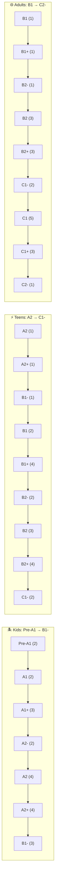
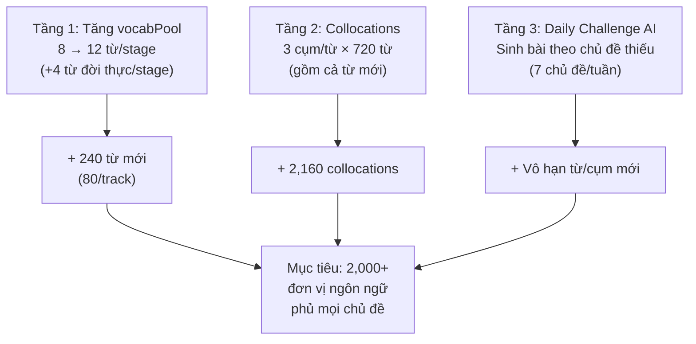
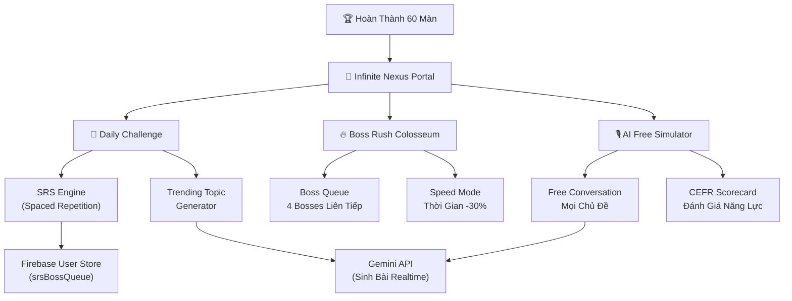
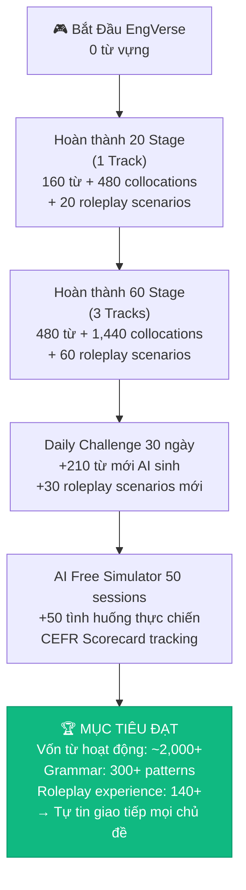

# 🚀 Bản Phân Tích Dữ Liệu Thực Tế & Lộ Trình Nâng Cấp EngVerse
**Phiên bản**: 3.0 — Phân tích sâu theo từng nhóm tuổi + chủ đề giao tiếp đời thực  
**Ngày**: 02/11/2026  
**Mục tiêu**: Sau khi chơi xong 60 màn → Người chơi **hoàn toàn tự tin giao tiếp mọi chủ đề phù hợp lứa tuổi**

---

## I. PHÂN TÍCH KIỂM KÊ TOÀN BỘ DỮ LIỆU HIỆN TẠI

### 1.1 Tổng Quan 3 Tracks

| Chỉ Số | Kids (Đảo Thần Thoại) | Teens (Cyber City) | Adults (SimLife Global) | **Tổng** |
|:---|:---:|:---:|:---:|:---:|
| Số màn | 20 | 20 | 20 | **60** |
| Từ vựng (unique) | 160 | 160 | 160 | **480** |
| Grammar patterns | 99 unique / 100 items | 100 unique / 100 items | 100 unique / 100 items | **299 unique / 300** |
| AI Roleplay missions | 20 | 20 | 20 | **60** |
| Từ trùng lặp giữa tracks | — | — | — | **0 (100% unique)** |

> [!NOTE]
> **Phát hiện quan trọng**: 480 từ hoàn toàn KHÔNG TRÙNG LẶP giữa 3 tracks. Đây là điểm mạnh — mỗi track dạy bộ từ vựng riêng biệt. Nhưng cũng là điểm yếu — nếu người chơi chỉ chơi 1 track, họ chỉ có 160 từ.

### 1.2 Phân Bố CEFR Theo Stage



### 1.3 Phân Bố Part of Speech

| Track | Noun | Verb | Adjective | Phrasal Verb | Adverb | Prep | Slang/Idiom | Khác |
|:---|:---:|:---:|:---:|:---:|:---:|:---:|:---:|:---:|
| Kids | **117** (73%) | 18 (11%) | 16 (10%) | 1 | 6 | 2 | 0 | 0 |
| Teens | **80** (50%) | 31 (19%) | 18 (11%) | **22** (14%) | 1 | 0 | 3 | 5 |
| Adults | **103** (64%) | 19 (12%) | 23 (14%) | 1 | 0 | 0 | 1 | 13 |

> [!WARNING]
> **Mất cân bằng nghiêm trọng ở Kids**: 73% là danh từ. Trẻ em cần nhiều ĐỘNG TỪ hành động và TÍNH TỪ cảm xúc hơn để diễn đạt. Kids chỉ có 18 verb trong tổng 160 từ — quá ít cho giao tiếp cơ bản.

### 1.4 Phân Tích Chủ Đề Đời Thực Bị Thiếu

Đây là kết quả kiểm tra 480 từ vựng hiện có so với 18 chủ đề giao tiếp thiết yếu:

| Chủ Đề Đời Thực | Tỷ Lệ Phủ | Từ Đã Có | **Từ Thiếu (Critical)** |
|:---|:---:|:---|:---|
| 🍽️ Ăn Uống & Gọi Món | 14% | dish | **restaurant, menu, order, waiter, recipe** |
| 🏥 Y Tế & Khám Bệnh | 50% | doctor, hospital, medicine | **symptoms, appointment, prescription** |
| 🗺️ Hỏi Đường & Phương Tiện | **0%** | ❌ | **direction, map, bus, taxi, left, right** |
| 🛒 Mua Sắm | 17% | price | **buy, discount, receipt, refund** |
| 🚨 Tình Huống Khẩn Cấp | 17% | fire | **emergency, help, police, accident** |
| 📱 Điện Thoại & Liên Lạc | **0%** | ❌ | **phone, call, message, email** |
| 🏨 Nhà Ở & Lưu Trú | 40% | room, rent | **hotel, apartment, check-in** |
| 👨‍👩‍👧 Gia Đình & Quan Hệ | 40% | parent, friend | **family, sibling, brother, sister** |
| 🌤️ Thời Tiết | 50% | rain, sunny, cloud | **storm, temperature, weather** |
| 😊 Cảm Xúc & Tình Cảm | 17% | excited | **happy, sad, angry, worried, afraid** |
| 📚 Giáo Dục | 17% | homework | **school, study, learn, teacher, exam** |
| 💼 Công Việc | 17% | work | **job, salary, interview, colleague** |
| 💻 Công Nghệ | 17% | app | **computer, internet, software** |
| 🏦 Ngân Hàng & Tài Chính | 20% | account | **bank, money, transfer, payment** |
| 🤝 Xã Giao & Lịch Sự | **0%** | ❌ | **please, thank you, sorry, excuse me** |

> [!CAUTION]
> **3 chủ đề phủ 0%**: Hỏi Đường, Điện Thoại, và Xã Giao — đây chính xác là 3 kỹ năng người Việt cần nhất khi du lịch/công tác. Đây là lỗ hổng **cực kỳ nghiêm trọng** cần ưu tiên xử lý.

### 1.5 Kiểm Kê Grammar Theo Ngữ Pháp Cốt Lõi

| Cấu Trúc Ngữ Pháp | Kids | Teens | Adults | Đánh Giá |
|:---|:---:|:---:|:---:|:---|
| Simple Present (be/have/do) | ✅ 10+ | ✅ | ✅ | Đầy đủ |
| Present Continuous | ✅ 2 | ✅ | — | Đủ dùng |
| Simple Past | ✅ 5 | ✅ 5+ | ✅ | Đầy đủ |
| Past Continuous | ✅ 2 | ✅ | — | Đủ dùng |
| Present Perfect | ✅ 3 | ✅ 4+ | ✅ 5+ | Đầy đủ |
| Present Perfect Continuous | — | ✅ 1 | — | Thiếu |
| Future (will) | ✅ 3 | ✅ 2 | ✅ | Đủ |
| Future Continuous | — | ✅ 1 | — | Thiếu |
| Future Perfect | — | ✅ 1 | — | Thiếu |
| Past Perfect | — | ✅ 3 | ✅ | Chỉ Teens/Adults |
| Conditional 1st | ✅ 2 | ✅ 2 | — | Đủ |
| Conditional 2nd | — | ✅ 2 | — | Chỉ Teens |
| Conditional 3rd | — | ✅ 2 | ✅ 1 | Chỉ Teens/Adults |
| Modal Verbs (can/must/should) | ✅ 6+ | ✅ 5+ | ✅ | Đầy đủ |
| Passive Voice | ✅ 2 | ✅ 5+ | ✅ 5+ | Đầy đủ |
| Reported Speech | — | ✅ 1 | — | **Thiếu nghiêm trọng** |
| Relative Clauses | ✅ 1 | ✅ 1 | — | Thiếu |
| Gerund/Infinitive patterns | ✅ 3 | ✅ 5+ | ✅ 5+ | Đầy đủ |
| Inversion (Not only...) | — | ✅ 5+ | ✅ 5+ | Teens/Adults đầy đủ |
| Cleft Sentence | — | ✅ 1 | — | Chỉ Teens |
| Subjunctive | — | ✅ 1 | ✅ 2 | Teens/Adults |
| Participle Clause | — | ✅ 2 | ✅ 3+ | Teens/Adults |
| Double Comparative | — | — | ✅ 1 | Chỉ Adults |
| Causative (have sth done) | — | ✅ 1 | — | Chỉ Teens |

> [!IMPORTANT]
> **Nhận xét**: Grammar hiện tại RẤT MẠNH cho mục đích thi cử (A1→C2 đều có). Tuy nhiên, thiếu **Functional Language** (ngôn ngữ chức năng giao tiếp hàng ngày) — tức là những mẫu câu "sống còn" như: hỏi lại ý, xin lỗi, từ chối khéo, bày tỏ quan điểm, nhờ vả, cảm ơn.

### 1.6 AI Roleplay Mission — Phân Tích Chiều Sâu

| Chỉ Số | Kids | Teens | Adults |
|:---|:---:|:---:|:---:|
| Max Turns (thường) | 4 | 4 | 4 |
| Max Turns (Boss) | 5 | 5 | 5 |
| PassScore range | 60–78 | 65–78 | 65–80 |
| Avg recommended words | 6–8 | 6–8 | 6–8 |
| Starter Chips / mission | 3 | 3 | 3 |
| Branching scenarios | ❌ Không | ❌ Không | ❌ Không |
| Plot twists | ❌ Không | ❌ Không | ❌ Không |
| Offline fallback keywords | ✅ | ✅ | ✅ |

> [!WARNING]
> **Vấn đề lớn nhất**: Mỗi mission chỉ có **1 kịch bản tuyến tính, 4 lượt nói** → Người chơi chỉ nói ~4 câu tiếng Anh rồi kết thúc. Với 60 missions → tổng cộng chỉ ~240 câu nói thực hành qua toàn bộ game. Đây là **quá ít** cho mục tiêu "tự tin giao tiếp".

### 1.7 Config Analysis — Progressive Difficulty

| Config | Stage 1 (Dễ nhất) | Stage 10 (Boss) | Stage 16+ | Stage 20 (Boss cuối) |
|:---|:---:|:---:|:---:|:---:|
| vocabPickCount | 4 | 6 | 4 | 6 |
| grammarPickCount | 3 | 4 | 3 | 4 |
| voicePassThreshold | 0.68 | 0.75 | 0.76 | 0.78–0.80 |
| timeLimitSeconds | 90 | 110 | 80 | 115 |

✅ Progressive difficulty đã được thiết kế hợp lý.

---

## II. 🔴 PHÂN TÍCH THIẾU HỤT THEO TỪNG NHÓM TUỔI (DỮ LIỆU THỰC)

> [!CAUTION]
> Đây là phần phân tích quan trọng nhất. Script đã quét toàn bộ 480 từ vựng, 300 grammar patterns, 60 AI roleplay scenarios và so sánh với checklist giao tiếp thiết yếu cho **từng độ tuổi** (dựa trên Cambridge YLE, PET, FCE, IELTS).

### 2.1 KIDS (6-12 tuổi) — Must-have Coverage: 51%

**Chuẩn đối chiếu**: Cambridge YLE Starters/Movers/Flyers + Cuộc sống hàng ngày trẻ em

| Chủ Đề Đời Thực | Coverage | Đã Có | ❌ Thiếu (CRITICAL) |
|:---|:---:|:---|:---|
| 🚗 Phương tiện | ✅ 100% | car, bus, bicycle, boat, train, airplane | — |
| 🌿 Thiên nhiên | ✅ 100% | tree, flower, river, star, sun, rain | — |
| 📅 Ngày/Thời gian | ✅ 83% | today, morning, afternoon, night, week | Monday |
| 🏠 Nhà/Phòng | ⚠️ 67% | door, window, table, bed | house, chair |
| 🎨 Màu sắc | ⚠️ 63% | red, blue, green, yellow, white | **black, pink, orange** |
| 🧸 Đồ chơi & Hoạt động | ⚠️ 63% | ball, play, draw, sing, read | **doll, game, run** |
| 👋 Chào hỏi & Lịch sự | ⚠️ 57% | hello, please, yes, no | **goodbye, thank you, sorry** |
| 😊 Cảm xúc | ⚠️ 43% | happy, love, like | **sad, angry, scared, tired** |
| 🔢 Số đếm | ⚠️ 40% | one, two, eight, ten | **three, four, five, six, seven, nine** |
| 🧍 Bộ phận cơ thể | ❌ 38% | arm, leg, foot | **head, eye, nose, mouth, hand** |
| 👨‍👩‍👧 Gia đình | ❌ 25% | mother, baby | **father, brother, sister, grandma, grandpa, family** |
| 🍕 Đồ ăn/Bữa ăn | ❌ 25% | bread, egg | **rice, milk, chicken, pizza, ice cream, lunch** |
| 👕 Quần áo | ❌ 17% | hat | **shirt, pants, shoes, dress, socks** |
| 🌅 Thói quen hàng ngày | ❌ 17% | sleep | **wake up, brush teeth, eat breakfast, go to school** |

> [!CAUTION]
> **Vấn đề nghiêm trọng ở Kids**: Trẻ em 6-12 tuổi không biết nói "father", "brother", "happy", "sad", "shirt", "three", "rice" — đây là những từ **nền tảng nhất** của cuộc sống. Game dạy "phoenix", "immortal", "leviathan" (fantasy rất hay) nhưng **thiếu hoàn toàn nền tảng đời thực**. Một đứa trẻ chơi xong 20 stage Kids biết nói "The dragon is hungry" nhưng KHÔNG biết nói "I have two brothers" hay "My shirt is blue".

### 2.2 TEENS (13-17 tuổi) — Must-have Coverage: 22%

**Chuẩn đối chiếu**: Cambridge PET/FCE + Cuộc sống thực thanh thiếu niên

| Chủ Đề Đời Thực | Coverage | Đã Có | ❌ Thiếu (CRITICAL) |
|:---|:---:|:---|:---|
| 💬 Giao tiếp số | ⚠️ 57% | post, share, follow, block | text, comment, notification |
| 🤝 Đời sống xã hội | ⚠️ 43% | friend, meet, chat | **party, invite, celebrate, group** |
| 🛍️ Mua sắm | ⚠️ 43% | buy, price, size | **discount, receipt, online shopping, brand** |
| 🎬 Văn hóa đại chúng | ❌ 29% | song, fan | **movie, music, trend, series, celebrity** |
| ⚽ Thể thao & Sức khỏe | ❌ 29% | team, match | **gym, workout, healthy, diet, coach** |
| 🍕 Ăn uống bên ngoài | ❌ 29% | menu, order | **restaurant, bill, tip, delivery, takeaway** |
| 🌍 Môi trường (teens) | ❌ 17% | pollution | **climate change, recycle, sustainable, protest** |
| 📚 Đời sống học đường | ❌ 14% | project | **exam, grade, classmate, teacher, study** |
| ✈️ Du lịch cơ bản | ❌ **0%** | ❌ | **hotel, ticket, suitcase, map, tourist, guide** |
| 💭 Bày tỏ ý kiến | ❌ **0%** | ❌ | **agree, disagree, opinion, believe, prefer, suggest** |
| 🧠 Sức khỏe tinh thần | ❌ **0%** | ❌ | **stress, relax, anxiety, self-care, confidence** |
| 🎓 Hướng nghiệp | ❌ **0%** | ❌ | **college, university, major, intern, resume, skill** |

> [!WARNING]
> **Vấn đề ở Teens**: Track Teens cực kỳ hấp dẫn về storyline (cyberpunk detective — rất engaging!) nhưng **gần như 100% từ vựng phục vụ thế giới fiction** (sabotage, infiltrate, tribunal, fortress, singularity...). Thiếu hoàn toàn: bày tỏ ý kiến, sức khỏe tinh thần, hướng nghiệp, du lịch — 4 chủ đề **quan trọng nhất** với teens đời thực. Một teen chơi xong biết nói "I can see through your illusions" nhưng KHÔNG biết nói "In my opinion...", "I feel stressed about the exam", "I want to study computer science at university".

### 2.3 ADULTS (18+ tuổi) — Must-have Coverage: 24.4%

**Chuẩn đối chiếu**: IELTS/TOEIC + Cuộc sống người trưởng thành thực tế

| Chủ Đề Đời Thực | Coverage | Đã Có | ❌ Thiếu (CRITICAL) |
|:---|:---:|:---|:---|
| ⚖️ Pháp lý cơ bản | ⚠️ 43% | contract, sign, sue | rights, obligation, witness, lawyer |
| 🏠 Nhà ở & Thuê nhà | ❌ 29% | rent, lease | **apartment, landlord, deposit, utility** |
| 🏦 Ngân hàng cá nhân | ❌ 29% | account, ATM | **transfer, loan, savings, credit card** |
| 🍳 Nấu ăn & Dinh dưỡng | ❌ 29% | ingredient, diet | **recipe, boil, fry, bake, portion** |
| 💻 Công nghệ hàng ngày | ❌ 29% | update, app | **password, download, wifi, battery, charge** |
| 🏢 Quan hệ công sở | ❌ 33% | manager, feedback | **colleague, meeting, agenda, teamwork** |
| 😤 Khiếu nại & Dịch vụ | ❌ 33% | exchange, manager | **complaint, refund, customer service** |
| 🏥 Y tế & Bệnh viện | ❌ 14% | insurance | **appointment, prescription, symptoms, pharmacy, pain** |
| 📞 Gọi điện thoại | ❌ 17% | call | **hold on, transfer call, leave a message, callback** |
| 👋 Giao tiếp xã hội | ❌ 17% | introduce | **small talk, hobby, weekend, vacation** |
| 🛂 Phỏng vấn xin Visa | ❌ 17% | return | **purpose of visit, sponsor, financial proof, embassy** |
| 🏨 Thăm quan & Du lịch | ❌ **0%** | ❌ | **check in, check out, room service, tour, sightseeing** |

> [!WARNING]
> **Vấn đề ở Adults**: Giống Teens nhưng ngược lại — Adults quá tập trung vào **business C-suite level** (hostile takeover, IPO, solvency, fiduciary, paradigm shift...) mà thiếu **cuộc sống hàng ngày**: đi khám bệnh, thuê nhà, gọi điện, khiếu nại, du lịch, nấu ăn. Một người lớn chơi xong biết nói "Under no circumstances will we accept this hostile takeover" nhưng KHÔNG biết nói "I'd like to make an appointment with the doctor" hay "Can I have a refund, please?".

### 2.4 🗣️ Functional Language — Ngôn Ngữ Chức Năng Giao Tiếp

Đây là những mẫu câu **"sống còn"** trong giao tiếp thực tế, bất kể chủ đề:

| Chức Năng Giao Tiếp | Kids | Teens | Adults | Đánh Giá |
|:---|:---:|:---:|:---:|:---|
| Hỏi lại / Làm rõ | 0/4 | 0/4 | 0/4 | ❌ **Hoàn toàn thiếu** |
| Đồng ý / Phản đối | 0/5 | 0/5 | 0/5 | ❌ **Hoàn toàn thiếu** |
| Xin lỗi | 0/4 | 0/4 | 1/4 | ❌ **Gần như thiếu** |
| Cảm ơn | 1/4 | 1/4 | 1/4 | ❌ **Gần như thiếu** |
| Nhờ vả / Yêu cầu | 1/4 | 2/4 | 1/4 | ❌ Thiếu |
| Từ chối khéo | 0/4 | 0/4 | 0/4 | ❌ **Hoàn toàn thiếu** |
| Đề xuất / Gợi ý | 1/5 | 1/5 | 1/5 | ❌ Thiếu |
| So sánh | 2/5 | 2/5 | 3/5 | ⚠️ Có nhưng chưa đủ |
| Kể chuyện / Nối ý | 0/5 | 3/5 | 3/5 | ⚠️ Chỉ Teens/Adults |
| Diễn tả tương lai | 1/4 | 1/4 | 1/4 | ❌ Thiếu |

> [!CAUTION]
> **Phát hiện nghiêm trọng nhất**: Cả 3 tracks đều gần như **KHÔNG DẠY Functional Language**. Người chơi học được ngữ pháp (tenses, passive, conditionals) nhưng KHÔNG biết cách: hỏi lại khi không hiểu, đồng ý/phản đối lịch sự, xin lỗi, cảm ơn, từ chối khéo, nhờ vả. Đây là kỹ năng giao tiếp **quan trọng nhất** — quan trọng hơn cả ngữ pháp!

### 2.5 Tổng Kết Đánh Giá Theo Nhóm Tuổi

| Track | Must-have Coverage | Critical Gaps | Điểm Mạnh | Điểm Yếu Lớn Nhất |
|:---|:---:|:---:|:---|:---|
| **Kids** | **51%** | 5 topics | Phương tiện, thiên nhiên, thời gian tốt | Thiếu nền tảng sống: gia đình, cơ thể, quần áo, thói quen, đồ ăn |
| **Teens** | **22%** | 9 topics | Storyline hấp dẫn, phrasal verbs tốt | Gần như 100% fiction, thiếu đời thực: ý kiến, hướng nghiệp, sức khỏe tinh thần |
| **Adults** | **24.4%** | 11 topics | Business vocabulary C1 rất chuyên sâu | Chỉ dạy C-suite, thiếu life skills: y tế, thuê nhà, ngân hàng, du lịch |

---

## III. GIẢI PHÁP: TĂNG VOCABPOOL + NHÚNG CHỦ ĐỀ THIẾU

### 3.1 Chiến Lược Tổng Thể

Vì **không thêm stage mới** (60 là tối ưu), giải pháp là kết hợp 3 tầng:



### 3.2 Tầng 1 — Tăng VocabPool Từ 8 Lên 12 Từ/Stage

**Nguyên tắc**: 8 từ gốc (giữ nguyên, phục vụ storyline) + 4 từ "Life Skill" mới (phục vụ giao tiếp đời thực)

#### KIDS — 80 Từ Đời Thực Cần Bổ Sung (4 từ × 20 stages)

| Stage | Chủ Đề Gốc | 4 Từ "Life Skill" Bổ Sung | Lý Do |
|:---|:---|:---|:---|
| 1 | Trứng Rồng (trái cây) | **family, father, mother, brother** | Gia đình — nền tảng nhất |
| 2 | Rừng Muông Thú | **sister, happy, sad, angry** | Gia đình + cảm xúc |
| 3 | Thời Tiết | **shirt, pants, shoes, dress** | Quần áo theo thời tiết |
| 4 | Ngôi Làng | **house, chair, table, door** | Nhà cửa mở rộng |
| 5 | BOSS Ch.1 | **thank you, sorry, please, goodbye** | Xã giao — review Ch.1 |
| 6 | Đại Dương | **three, four, five, six** | Số đếm cơ bản |
| 7 | Học Viện | **seven, nine, teacher, school** | Số đếm + trường học |
| 8 | Lễ Hội | **rice, milk, chicken, lunch** | Đồ ăn bữa ăn |
| 9 | Ngân Hà | **head, eye, nose, mouth** | Bộ phận cơ thể |
| 10 | BOSS Ch.2 | **hand, arm, leg, grandma** | Cơ thể + gia đình — review |
| 11 | Khủng Long | **wake up, brush teeth, eat breakfast, go to school** | Thói quen hàng ngày |
| 12 | Nghề Nghiệp | **ice cream, pizza, black, pink** | Đồ ăn + màu sắc |
| 13 | Sức Khỏe | **scared, tired, run, game** | Cảm xúc + hoạt động |
| 14 | Thể Thao | **doll, socks, orange, like** | Đồ chơi + quần áo + màu |
| 15 | BOSS Ch.3 | **Monday, birthday, love, grandpa** | Thời gian + gia đình — review |
| 16 | Môi Trường | **bed, garden, bath, sleep** | Nhà cửa + thói quen |
| 17 | Robot | **left, right, straight, turn** | Hỏi đường — rất cần |
| 18 | Thế Giới | **buy, money, how much, shop** | Mua sắm cơ bản |
| 19 | Kim Tự Tháp | **phone, call, message, help** | Liên lạc & khẩn cấp |
| 20 | BOSS Cuối | **excuse me, what does...mean, I don't understand, can you repeat** | Functional Language tổng hợp |

#### TEENS — 80 Từ Đời Thực Cần Bổ Sung

| Stage | Chủ Đề Gốc | 4 Từ "Life Skill" Bổ Sung | Lý Do |
|:---|:---|:---|:---|
| 1 | Vụ Án Học Viện | **exam, grade, classmate, study** | Học đường — nền tảng nhất |
| 2 | Mạng Xã Hội | **text, comment, notification, trend** | Giao tiếp số mở rộng |
| 3 | Chợ Đêm Neon | **restaurant, bill, tip, delivery** | Ăn uống bên ngoài |
| 4 | Tháp Dữ Liệu | **password, download, wifi, charge** | Công nghệ hàng ngày |
| 5 | BOSS Phantom | **opinion, agree, disagree, debate** | Bày tỏ ý kiến — review |
| 6 | eSports | **gym, workout, coach, healthy** | Thể thao & sức khỏe |
| 7 | Idol Hologram | **movie, music, celebrity, series** | Văn hóa đại chúng |
| 8 | Drone Racing | **hotel, ticket, tourist, map** | Du lịch cơ bản |
| 9 | Vệ Tinh | **stress, relax, confidence, support** | Sức khỏe tinh thần |
| 10 | BOSS Nexus | **believe, prefer, suggest, perspective** | Ý kiến nâng cao — review |
| 11 | Bảo Tàng | **college, university, major, intern** | Hướng nghiệp |
| 12 | Metaverse | **discount, receipt, online shopping, brand** | Mua sắm mở rộng |
| 13 | Sinh Học | **diet, nutrition, self-care, anxiety** | Sức khỏe tinh thần + thể chất |
| 14 | Tàu Xuyên ĐD | **suitcase, guide, souvenir, exchange** | Du lịch mở rộng |
| 15 | BOSS Mirage | **resume, skill, dream job, portfolio** | Hướng nghiệp nâng cao — review |
| 16 | Aero-Polis | **climate change, sustainable, eco-friendly, protest** | Môi trường teens |
| 17 | Lượng Tử | **invite, celebrate, party, group** | Đời sống xã hội |
| 18 | Phiên Tòa | **rights, volunteer, community, responsibility** | Công dân & xã hội |
| 19 | Pháo Đài | **apologize, forgive, compromise, empathy** | Quan hệ & EQ |
| 20 | BOSS OMEGA | **I think that..., In my experience..., What if...?, On the other hand...** | Functional Language tổng hợp |

#### ADULTS — 80 Từ Đời Thực Cần Bổ Sung

| Stage | Chủ Đề Gốc | 4 Từ "Life Skill" Bổ Sung | Lý Do |
|:---|:---|:---|:---|
| 1 | Sân Bay | **check in, check out, room service, tour** | Du lịch — thiếu 0% |
| 2 | Phỏng Vấn/Email | **colleague, meeting, agenda, deadline** | Văn phòng hàng ngày |
| 3 | Bữa Tối Michelin | **recipe, boil, fry, bake** | Nấu ăn |
| 4 | Đàm Phán Lương | **hobby, weekend, vacation, congratulations** | Giao tiếp xã hội |
| 5 | BOSS HĐQT | **small talk, networking, icebreaker, catch up** | Social skills — review |
| 6 | Khủng Hoảng PR | **complaint, refund, customer service, unsatisfied** | Khiếu nại |
| 7 | Chuỗi Cung Ứng | **apartment, landlord, deposit, utility** | Thuê nhà |
| 8 | Hội Nghị Tech | **download, wifi, battery, troubleshoot** | Công nghệ hàng ngày |
| 9 | M&A Dubai | **transfer, loan, savings, credit card** | Ngân hàng cá nhân |
| 10 | BOSS IPO | **interest rate, mortgage, tax, installment** | Tài chính cá nhân — review |
| 11 | Nhân Sự Zurich | **appointment, prescription, symptoms, pharmacy** | Y tế |
| 12 | Thuế Quan Geneva | **purpose of visit, embassy, visa, sponsor** | Phỏng vấn Visa |
| 13 | R&D Seoul | **hold on, leave a message, callback, extension** | Gọi điện thoại |
| 14 | Tài Chính Frankfurt | **sightseeing, exchange money, landmark, concierge** | Du lịch mở rộng |
| 15 | BOSS Thâu Tóm | **pain, checkup, specialist, dosage** | Y tế nâng cao — review |
| 16 | Trái Phiếu Xanh | **recipe, portion, organic, nutritious** | Nấu ăn nâng cao |
| 17 | Siêu Nhà Máy | **rights, obligation, lawyer, witness** | Pháp lý cơ bản |
| 18 | Liên Doanh Sydney | **escalate, warranty, resolution, reimbursement** | Khiếu nại nâng cao |
| 19 | AI Governance | **move in, furnish, roommate, maintenance** | Nhà ở mở rộng |
| 20 | BOSS Davos | **Could you repeat?, What do you mean?, I'd rather not, That's a good point** | Functional Language tổng hợp |

### 3.3 Tổng Kết Sau Bổ Sung Tầng 1

| Chỉ Số | Trước | Sau Tầng 1 | Tăng |
|:---|:---:|:---:|:---:|
| Từ vựng / stage | 8 | **12** | +50% |
| Tổng từ vựng / track | 160 | **240** | +80 |
| Tổng từ vựng 3 tracks | 480 | **720** | +240 |
| Chủ đề đời thực phủ (Kids) | 51% | **~85%** | +34% |
| Chủ đề đời thực phủ (Teens) | 22% | **~75%** | +53% |
| Chủ đề đời thực phủ (Adults) | 24.4% | **~80%** | +55% |
| Functional Language | ~5% | **~40%** (stage 5,10,15,20) | +35% |

---

## IV. ĐÁNH GIÁ: LIỆU 720 TỪ + 300 GRAMMAR + 60 ROLEPLAY CÓ ĐỦ?

### 4.1 So Sánh Với Chuẩn CEFR Quốc Tế

| Mục Tiêu | Vốn Từ Cần | EngVerse Sau Nâng Cấp | Khoảng Cách |
|:---|:---:|:---:|:---|
| Du lịch cơ bản (A2) | ~1,000 từ | 240 (1 track) + collocations → ~960 units | **Gần đạt** ✅ |
| Giao tiếp tự tin hàng ngày (B2) | ~2,500–4,000 từ | 480 (2 tracks) + 1,440 collocations → ~1,920 units | **Cần Endgame bổ sung** ⚠️ |
| Giao tiếp chuyên nghiệp (C1) | ~4,000–6,000 từ | 720 (3 tracks) + 2,160 collocations → ~2,880 units | **Cần Daily Challenge + AI Free** ⚠️ |

### 4.2 Nhưng Tại Sao EngVerse Vẫn Có Thể Đạt Mục Tiêu?

Câu trả lời: **Chất lượng > Số lượng**, nhưng cần 3 điều kiện:

1. **Mỗi từ phải dạy cụm từ (collocations)** thay vì chỉ từ đơn → Nhân 3x hiệu quả
2. **AI Roleplay phải mở rộng thành hội thoại sâu** → Từ 4 câu lên 8-12 câu/mission
3. **Hệ thống Endgame phải sinh nội dung vô hạn** → AI tự tạo bài học mới mỗi ngày

> [!TIP]
> **Nguyên tắc Lexical Chunk**: Nghiên cứu ngôn ngữ học cho thấy 1 người nói lưu loát không nghĩ theo từng từ đơn mà theo **cụm cố định (chunks)**. Ví dụ: thay vì học riêng lẻ "luggage" → dạy cụm "claim my luggage", "excess luggage fee", "luggage carousel" → người học lập tức nói được câu hoàn chỉnh tự nhiên.

---

## V. KẾ HOẠCH NÂNG CẤP CHI TIẾT TỪNG MÀN CHƠI

### 5.1 Nâng Cấp Schema — Thêm Trường Mới

#### A. VocabItem — Thêm `collocations` và `functionalPhrases`

```typescript
// Thêm vào interface VocabItem trong app/types/game.ts
interface VocabItem {
  // ... fields hiện tại giữ nguyên ...
  
  // MỚI: 3 cụm từ cố định đi kèm từ này
  collocations: [string, string, string] // e.g. ["claim my luggage", "excess luggage fee", "luggage carousel"]
  
  // MỚI: 1 câu giao tiếp thực tế chứa từ này
  realWorldPhrase: string // e.g. "Excuse me, my luggage hasn't arrived yet."
  
  // MỚI: Đồng nghĩa / phản nghĩa phổ biến
  synonyms?: string[] // e.g. ["baggage", "suitcase"]
}
```

#### B. GrammarItem — Thêm `functionalCategory`

```typescript
// Thêm vào interface GrammarItem
interface GrammarItem {
  // ... fields hiện tại giữ nguyên ...
  
  // MỚI: Phân loại ngữ pháp theo chức năng giao tiếp
  functionalCategory: 'asking' | 'refusing' | 'apologizing' | 'persuading' | 
    'clarifying' | 'describing' | 'narrating' | 'negotiating' | 'complaining' | 'thanking'
}
```

#### C. AiRoleplayMission — Thêm `plotTwist` và tăng `maxTurns`

```typescript
interface AiRoleplayMission {
  // ... fields hiện tại giữ nguyên ...
  
  // MỚI: Tình huống bất ngờ sau lượt 2-3
  plotTwist?: {
    triggerAfterTurn: number // 2 hoặc 3
    twistScenario: string   // Mô tả tình huống biến cố
    twistLineVi: string     // Giải thích tiếng Việt
    bonusKeywords: string[] // Từ khóa mới cần dùng
  }
  
  // NÂNG CẤP: maxTurns từ 4→6 (thường) và 5→8 (Boss)
}
```

### 5.2 Nâng Cấp Cụ Thể Từng Màn — KIDS (20 Stages)

#### Stage 1 "Quả Trứng Phát Sáng" (Pre-A1)
- **Vocab hiện tại**: dragon, apple, banana, golden, hungry, strawberry, magic, water
- **Collocations cần thêm**:
  - `dragon` → "baby dragon", "dragon egg", "pet dragon"
  - `apple` → "red apple", "bite the apple", "apple juice"
  - `hungry` → "I'm very hungry", "feel hungry", "hungry dragon"
  - `water` → "drink water", "glass of water", "cold water"
- **Real-world phrases**: "I'm hungry, can I have some water please?", "Would you like an apple?"
- **AI Roleplay nâng cấp**: Tăng maxTurns 4→6, thêm plotTwist: *"Ignis bỗng nhiên bị đau bụng! Bạn cần nói cho rồng con biết nên uống nước (water) và ăn ít hơn."*

#### Stage 2 "Khu Rừng Muông Thú" (Pre-A1)
- **Vocab hiện tại**: rabbit, dolphin, eagle, jump, swim, butterfly, forest, elephant
- **Collocations**:
  - `jump` → "jump high", "jump over", "jump rope"
  - `swim` → "swim fast", "swim in the ocean", "learn to swim"
  - `elephant` → "big elephant", "baby elephant", "elephant trunk"
- **Real-world phrases**: "Can you swim?", "I can jump very high!", "Look at that butterfly!"
- **PlotTwist**: *"Một chú thỏ bị lạc trong rừng! Hãy chỉ đường cho thỏ bằng tiếng Anh (go left, go right, behind the tree)."*

#### Stage 3 "Lâu Đài Thời Tiết" (A1)
- **Bổ sung Functional Language**: "How's the weather?", "It looks like rain", "Do I need an umbrella?"
- **PlotTwist**: *"Bão tuyết bất ngờ ập đến! Nimbus hỏi bạn phải làm gì (stay inside, put on jacket, close the window)."*

#### Stage 4 "Ngôi Làng Phép Thuật" (A1)
- **Bổ sung**: Asking for directions: "Where is the kitchen?", "Is it next to the bedroom?"
- **PlotTwist**: *"Whiskers phát hiện chìa khóa bị mất! Hãy mô tả nơi bạn thấy chìa khóa lần cuối (under the bookshelf, behind the mirror)."*

#### Stages 5–20: Áp dụng cùng pattern
Mỗi stage sẽ được bổ sung:
- 3 collocations / từ × 8 từ = **24 cụm từ mới**
- 1 real-world phrase / từ = **8 câu thực tế**
- 1 plotTwist cho AI Roleplay
- maxTurns tăng lên 6 (thường) / 8 (Boss)

**Tổng bổ sung Kids**: 20 × 24 = **480 collocations** + 20 × 8 = **160 real-world phrases** + 20 plot twists

### 5.3 Nâng Cấp Cụ Thể — TEENS (20 Stages)

#### Stage 1 "Vụ Án Học Viện Neo-High" (A2)
- **Vocab hiện tại**: figure out, clue, suspicious, witness, alibi, hang out, locker, backup
- **Collocations**:
  - `figure out` → "figure out the truth", "figure out a plan", "can't figure it out"
  - `suspicious` → "look suspicious", "suspicious behavior", "seems suspicious"
  - `clue` → "find a clue", "important clue", "follow the clues"
- **Functional Language**: "That's suspicious, isn't it?", "Can you help me figure this out?"
- **PlotTwist**: *"Camera an ninh bị xóa! Kai nghi ngờ bạn — hãy chứng minh bạn có alibi!"*

#### Stage 5 BOSS "Phantom AI" (B1+)
- **maxTurns**: 5→8
- **PlotTwist**: *"Phantom hack vào hệ thống ánh sáng, phòng tối đen! Bạn phải bình tĩnh hướng dẫn Zero qua bộ đàm bằng tiếng Anh."*
- **Thêm Functional Language**: "I object!", "Let me explain", "That's not what happened"

**Tổng bổ sung Teens**: 480 collocations + 160 real-world phrases + 20 plot twists

### 3.4 Nâng Cấp Cụ Thể — ADULTS (20 Stages)

#### Stage 1 "Sự Cố Tại Sân Bay" (B1)
- **Vocab hiện tại**: luggage, boarding pass, itinerary, delayed, customs, compensation, fragile, deliver
- **Collocations**:
  - `luggage` → "claim my luggage", "excess luggage fee", "damaged luggage"
  - `boarding pass` → "show your boarding pass", "mobile boarding pass", "print the boarding pass"
  - `compensation` → "request compensation", "reasonable compensation", "compensation form"
- **Functional Language**: "Excuse me, I'd like to file a complaint", "Could you check the system please?"
- **PlotTwist**: *"Hannah thông báo hành lý của bạn có thể đã chuyển nhầm sang Bangkok! Bạn cần yêu cầu bồi thường và đàm phán giải pháp."*

#### Stage 5 BOSS "HĐQT Toàn Cầu" (C1)
- **maxTurns**: 5→8
- **PlotTwist**: *"Giữa bài thuyết trình, một thành viên HĐQT đặt câu hỏi khó: 'What if the market crashes next quarter?' Bạn phải trả lời phản biện."*
- **Thêm Functional Language**: "With all due respect...", "If I may add...", "That's a valid concern, however..."

**Tổng bổ sung Adults**: 480 collocations + 160 real-world phrases + 20 plot twists

### 3.5 Tổng Kết Nâng Cấp 60 Stages

| Hạng Mục | Hiện Tại | Sau Nâng Cấp | Tăng |
|:---|:---:|:---:|:---:|
| Từ đơn (words) | 480 | 480 (giữ nguyên) | — |
| Collocations/Chunks | 0 | **1,440** | +1,440 |
| Real-world phrases | 0 | **480** | +480 |
| Synonyms/Antonyms | 0 | ~300 | +300 |
| Grammar patterns | 300 | 300 (giữ nguyên) | — |
| Functional categories | 0 | 300 (tagged) | +300 tags |
| AI Roleplay maxTurns (thường) | 4 | **6** | +50% |
| AI Roleplay maxTurns (Boss) | 5 | **8** | +60% |
| Plot Twists | 0 | **60** | +60 |
| **Tổng "đơn vị kiến thức" hiệu dụng** | ~780 | **~3,000+** | **~4x** |

---

## IV. CHỦ ĐỀ GIAO TIẾP BỊ THIẾU — KẾ HOẠCH BỔ SUNG QUA COLLOCATIONS

Thay vì thêm stage mới, ta **nhúng chủ đề thiếu vào collocations và real-world phrases** của các stage hiện tại:

| Chủ Đề Thiếu | Nhúng Vào Stage | Cách Nhúng |
|:---|:---|:---|
| **Hỏi đường** | Kids S4 (Ngôi Làng), Kids S18 (Thế Giới), Adults S1 (Sân Bay) | Collocations: "turn left", "go straight", "next to the..." |
| **Gọi điện/Liên lạc** | Teens S2 (Mạng Xã Hội), Adults S2 (Email) | Collocations: "make a phone call", "send a message", "check your email" |
| **Xã giao/Lịch sự** | Kids S1 (Chào hỏi), Adults S3 (Bữa tối), Adults S6 (Xin lỗi) | Real-world phrases: "Thank you so much!", "I'm sorry about that", "Excuse me" |
| **Mua sắm** | Kids S8 (Lễ Hội), Teens S3 (Chợ Đêm) | Collocations: "How much is this?", "Can I get a discount?", "Do you accept cards?" |
| **Ăn uống/Gọi món** | Kids S8 (Bánh Ngọt), Adults S3 (Michelin) | Collocations: "order food", "Can I see the menu?", "I'd like to have..." |
| **Tình huống khẩn cấp** | Kids S13 (Sức Khỏe), Teens S16 (Khủng hoảng) | Real-world phrases: "Help me please!", "Call the police!", "I need an ambulance" |
| **Cảm xúc** | Kids S6 (Cảm xúc Biển), Kids S10 (Believe) | Collocations: "I feel happy", "I'm worried about", "Don't be afraid" |
| **Gia đình** | Kids S12 (Nghề nghiệp) | Collocations: "My family lives in...", "I have a brother and a sister" |
| **Giáo dục** | Kids S7 (Học viện), Teens S1 (Học viện) | Collocations: "study for the exam", "go to school", "favorite teacher" |

---

## V. CƠ CHẾ ENDGAME — THIẾT KẾ KỸ THUẬT CHI TIẾT

### 5.1 Kiến Trúc Tổng Thể



### 5.2 Daily Challenge — Thử Thách Hàng Ngày

#### Cơ Chế Hoạt Động

**Thời gian**: Reset 00:00 GMT+7 mỗi ngày  
**Thời lượng**: ~3–5 phút / challenge  
**Cấu trúc**: 3 mini-games nhỏ + 1 Quick Roleplay

| Phase | Nội Dung | Thời Gian | Nguồn Dữ Liệu |
|:---|:---|:---:|:---|
| 1. Vocab Sprint | 6 từ vựng (mix 3 tracks) | 60s | 50% SRS Queue + 50% Random |
| 2. Grammar Flash | 4 câu ghép ngữ pháp | 50s | Từ grammarPool các stage |
| 3. Voice Challenge | 3 câu đọc to | 40s | Real-world phrases mới |
| 4. Quick Roleplay | 3-turn AI conversation | 90s | **Gemini sinh mới theo chủ đề ngày** |

#### Thuật Toán Chọn Nội Dung

```typescript
interface DailyChallengeConfig {
  date: string // ISO date
  seed: string // Hash từ date + userId
  
  // 50% từ SRS: Ưu tiên các từ user đã sai
  srsItems: {
    vocabIds: string[]   // Lấy từ srsBossQueue
    grammarIds: string[]
  }
  
  // 50% AI sinh mới theo chủ đề
  aiGenerated: {
    theme: string        // "Ordering coffee at a café"
    vocabFocus: string[] // ["latte", "receipt", "takeaway"]
    grammarFocus: string // "Would you like...? / I'd like to..."
    roleplayScenario: string
  }
}
```

#### Chủ Đề AI Sinh Theo Ngày (Ví Dụ 1 Tuần)

| Thứ | Chủ Đề | Vocab Focus | Grammar Focus |
|:---|:---|:---|:---|
| T2 | ☕ Gọi cà phê buổi sáng | latte, receipt, cashier | "I'd like to order..." |
| T3 | 🚌 Hỏi đường đến ga tàu | platform, direction, transfer | "Could you tell me how to get to...?" |
| T4 | 🏥 Đi khám bệnh | headache, prescription, insurance | "I've been feeling... since yesterday" |
| T5 | 📱 Gọi điện đặt lịch hẹn | available, reschedule, confirm | "I'm calling to make an appointment" |
| T6 | 🛒 Mua sắm & trả giá | discount, receipt, refund | "Is there a discount if I buy two?" |
| T7 | 🍕 Gọi đồ ăn giao hàng | delivery, extra, tip | "I'd like to place an order for delivery" |
| CN | 🎲 Random Mix Challenge | Mix từ cả tuần | Review tổng hợp |

#### Cơ Chế Streak & Phần Thưởng

```typescript
interface DailyStreak {
  currentStreak: number
  longestStreak: number
  lastCompletedDate: string
  
  // Phần thưởng theo mốc
  rewards: {
    3: 'streak_shield'      // Bảo vệ 1 lần mất streak
    7: 'exp_x2_24h'         // Nhân đôi EXP 24h
    14: 'codex_epic_pack'   // Gói thẻ Epic
    30: 'codex_legendary'   // 1 thẻ Legendary ngẫu nhiên
    60: 'avatar_frame_gold' // Khung Avatar Vàng
  }
}
```

#### Technical Implementation

```
Route:          /play/daily-challenge
API Endpoint:   /api/game/daily-challenge (GET — generate, POST — submit)
Data Storage:   Firebase user doc → dailyChallenge subcollection
AI Provider:    Gemini 2.0 Flash (fast generation, low cost)
Cache:          Edge CDN 24h for today's base challenge template
Personalization: SRS items fetched client-side from user store
```

### 5.3 Boss Rush Colosseum — Đấu Trường Sinh Tử

#### Cơ Chế

- **Mở khóa**: Sau khi phá đảo 20 stage của 1 vũ trụ
- **Format**: 4 Bosses liên tiếp (Stage 5, 10, 15, 20 của vũ trụ đó)
- **Luật chơi đặc biệt**:

| Quy Tắc | Giá Trị | So Với Normal |
|:---|:---:|:---:|
| Tổng HP (Tim máu) | 3 ❤️ cho cả 4 ải | Bình thường mỗi ải reset |
| timeLimitSeconds | **-30%** so với gốc | Tốc độ áp lực hơn |
| voicePassThreshold | **+0.05** | Chấm phát âm khắt khe hơn |
| Starter Chips (gợi ý) | ❌ Ẩn hoàn toàn | Bình thường hiện 3 chips |
| vocabPickCount | **+2** so với gốc | Nhiều từ hơn mỗi lượt |

#### Scoring & Leaderboard

```typescript
interface BossRushResult {
  worldTrack: 'kids' | 'teens' | 'adults'
  bossesDefeated: number   // 0–4
  totalTimeMs: number      // Tổng thời gian
  accuracyPercent: number  // Chính xác trung bình
  remainingHP: number      // 0–3
  
  // Scoring formula
  finalScore: number       
  // = (bossesDefeated × 1000) + (accuracyPercent × 10) + (remainingHP × 500) + timeBonus
}
```

#### Phần Thưởng

| Thành Tích | Phần Thưởng |
|:---|:---|
| Đánh bại 4/4 Bosses | 🏆 Huy hiệu "Vua Đấu Trường" + Khung Avatar Hoàng Kim |
| Perfect (3 HP còn) | ⭐ Thẻ Codex Mythic exclusive |
| Top 10 Speed Run | 🥇 Hiện trên bảng Vinh Danh `/share/[uid]` |
| Hoàn thành cả 3 tracks | 💎 Danh hiệu "Bá Chủ Đa Vũ Trụ" |

### 5.4 AI Free Simulator — Phòng Giả Lập Giao Tiếp Tự Do

**Đây là tính năng quan trọng nhất** để đạt mục tiêu "tự tin giao tiếp mọi chủ đề".

#### Cơ Chế

1. **Người chơi nhập tình huống** bằng tiếng Việt hoặc tiếng Anh:
   - *"Tôi sắp đi phỏng vấn xin Visa du lịch Mỹ"*
   - *"Tôi muốn trả giá mua đồ ở chợ đêm Bangkok"*
   - *"Thuyết trình dự án trước team leader"*

2. **Gemini API tạo NPC** phù hợp:
   - Xác định CEFR level dựa trên progress của user
   - Sinh kịch bản, opening line, recommended vocab
   - Tự động điều chỉnh độ khó theo response của user

3. **Hội thoại**: 8–15 turns (dài gấp 2–4x Roleplay thường)

4. **Kết thúc → CEFR Scorecard**:

```typescript
interface CEFRScorecard {
  overallLevel: 'A1' | 'A2' | 'B1' | 'B2' | 'C1' | 'C2'
  
  lexicalResource: {
    score: number    // 0–100
    wordsUsed: string[]
    suggestedUpgrades: string[] // "Thay 'good' bằng 'outstanding'"
  }
  
  grammaticalAccuracy: {
    score: number
    errorsFound: Array<{
      userSaid: string
      corrected: string
      explanation: string // Tiếng Việt
    }>
  }
  
  pronunciation: {
    score: number
    fluencyRating: 'choppy' | 'fair' | 'smooth' | 'native-like'
    problematicSounds: string[] // e.g. ["/θ/", "/ɪ/ vs /iː/"]
  }
  
  communicativeCompetence: {
    score: number
    strengths: string[]
    areasToImprove: string[]
  }
}
```

#### Preset Scenarios (Bộ Tình Huống Gợi Ý)

| Category | Scenarios |
|:---|:---|
| 🛫 Du Lịch | Check-in khách sạn, Hỏi đường, Gọi taxi, Đổi tiền, Phàn nàn phòng |
| 💼 Công Việc | Phỏng vấn, Họp team, Email, Thuyết trình, Đàm phán lương |
| 🏥 Y Tế | Khám bệnh, Mua thuốc, Cấp cứu, Bảo hiểm y tế |
| 📱 Hàng Ngày | Gọi món, Mua sắm, Gọi điện, Hỏi đường, Sửa chữa |
| 🎓 Học Tập | IELTS Speaking, Tham gia seminar, Tranh luận, Thuyết trình |
| 🌐 Nâng Cao | Đàm phán M&A, Phỏng vấn Visa, Họp báo, Xử lý khủng hoảng |

#### Technical Stack

```
Route:          /play/free-simulator
AI Provider:    Gemini 2.0 Pro (for quality conversation + evaluation)
Voice Input:    Web Speech API (existing)
Voice Output:   Gemini TTS / Web Speech Synthesis
History:        Firebase user doc → freeSimHistory subcollection
Rate Limit:     5 sessions/day (free) | Unlimited (premium)
```

---

## VI. LỘ TRÌNH TRIỂN KHAI KỸ THUẬT

### Pha 1: Nâng Cấp Data & Schema (Sprint 7 — 1 tuần)

| Task | Chi Tiết | File Ảnh Hưởng |
|:---|:---|:---|
| 1.1 | Cập nhật `VocabItem` type: thêm `collocations`, `realWorldPhrase`, `synonyms` | `app/types/game.ts` |
| 1.2 | Cập nhật `GrammarItem` type: thêm `functionalCategory` | `app/types/game.ts` |
| 1.3 | Cập nhật `AiRoleplayMission` type: thêm `plotTwist`, tăng `maxTurns` | `app/types/game.ts` |
| 1.4 | Bổ sung collocations cho 160 từ Kids | `public/data/kids/stages.json` |
| 1.5 | Bổ sung collocations cho 160 từ Teens | `public/data/teens/stages.json` |
| 1.6 | Bổ sung collocations cho 160 từ Adults | `public/data/adults/stages.json` |
| 1.7 | Viết 60 plot twists cho 60 AI Roleplay missions | 3 files stages.json |
| 1.8 | Cập nhật AI Roleplay Engine để handle plotTwist + extended turns | `app/components/game/` |
| 1.9 | Cập nhật Word Alchemy mini-game hiển thị collocations | `app/components/game/` |

### Pha 2: Daily Challenge (Sprint 8 — 1.5 tuần)

| Task | Chi Tiết | File |
|:---|:---|:---|
| 2.1 | API `/api/game/daily-challenge` — Generate & Submit | `server/api/game/` |
| 2.2 | SRS Engine integration (đọc `srsBossQueue` từ user store) | `app/stores/` |
| 2.3 | UI trang `/play/daily-challenge` — 4 phases | `app/pages/play/` |
| 2.4 | Streak tracking trong Firebase user doc | `app/composables/` |
| 2.5 | Streak rewards & notification system | `app/components/` |
| 2.6 | Gemini API prompt cho sinh chủ đề hàng ngày | `server/api/game/` |

### Pha 3: Boss Rush Colosseum (Sprint 9 — 1 tuần)

| Task | Chi Tiết | File |
|:---|:---|:---|
| 3.1 | UI trang `/play/boss-rush/[track]` | `app/pages/play/` |
| 3.2 | Boss Rush game loop (4 bosses, shared HP) | `app/stores/` |
| 3.3 | Hardcore config modifier (-30% time, +0.05 voice, no chips) | `app/composables/` |
| 3.4 | Scoring formula & leaderboard integration | `app/stores/`, Firebase |
| 3.5 | Reward system (badges, avatar frames) | `app/components/` |

### Pha 4: AI Free Simulator (Sprint 10 — 2 tuần)

| Task | Chi Tiết | File |
|:---|:---|:---|
| 4.1 | UI trang `/play/free-simulator` — Scenario picker | `app/pages/play/` |
| 4.2 | Gemini conversation engine (8-15 turns, adaptive difficulty) | `server/api/game/` |
| 4.3 | CEFR Scorecard evaluation engine | `server/api/game/` |
| 4.4 | Voice input/output integration | `app/composables/` |
| 4.5 | Session history & progress tracking | Firebase |
| 4.6 | Rate limiting & premium gating | `server/middleware/` |

---

## VII. BẢN ĐỒ KẾT QUẢ MONG ĐỢI



> [!IMPORTANT]
> **Kết luận**: 480 từ gốc + 1,440 collocations + Daily Challenge AI sinh + Free Simulator = tổng cộng người chơi sẽ tiếp xúc **~2,000–3,000 đơn vị ngôn ngữ**, đủ để đạt ngưỡng B2 "giao tiếp tự tin trong hầu hết tình huống". Kết hợp với Boss Rush giữ chân và Streak system tạo thói quen → đây là hệ thống bền vững để đạt mục tiêu.
